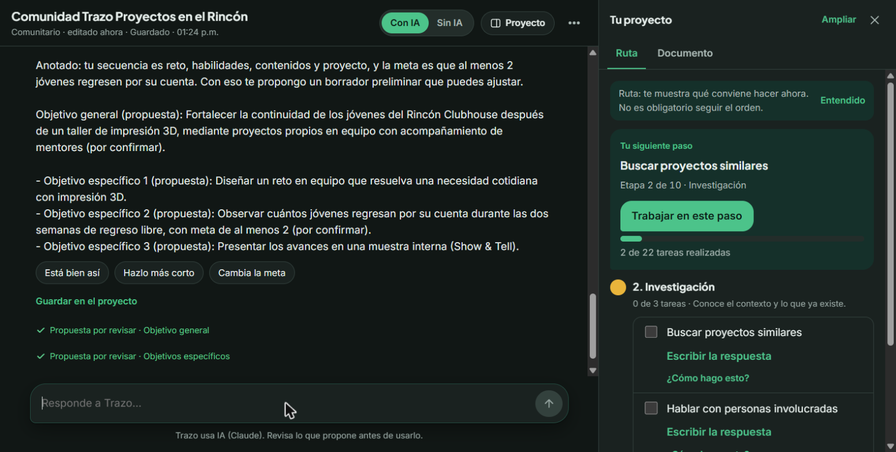
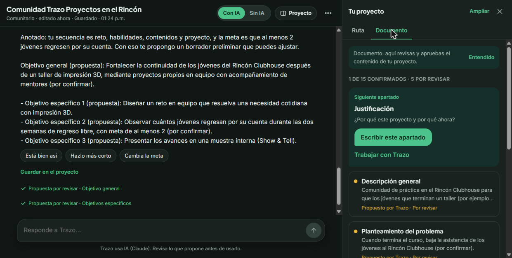

# Bitácora de activación

Solo registramos lo que ocurrió. Lo que no se pudo hacer también queda anotado, con lo que haremos.

---

## Activación 1 · Ensayo de Show & Tell (ejecutada)

- **Fecha:** 22 de octubre de 2026, virtual.
- **Anfitrión:** el docente facilitador del curso, con dos moderadores voluntarios por turnos.
- **Participantes:** estudiantes del curso que mostraron unos 10 proyectos en desarrollo (plataformas educativas, un servidor de juego para enseñar, biomateriales, una olimpiada de IA, entre otros). Kevin participó y elaboró el registro.
- **Registro completo:** [Reto 4 · Registro del Show & Tell](https://github.com/Universidad-Cenfotec/SINT-741-Curso-Activadores/pull/83).
- **Dónde ocurrió:** en la comunidad del curso, no en el Rincón. La traemos aquí porque de ella sale el ritual de Show & Tell que usaremos en el Rincón.

### Dos interacciones concretas

| Quién aportó | Qué dijo o hizo | Qué produjo |
|---|---|---|
| Una participante → la autora de una plataforma de nanocursos | Preguntó cómo se relacionaban el chatbot, el video y los paneles laterales | La autora aclaró la relación entre contenidos, nanocursos y apuntes; la propuesta se volvió más comprensible |
| Una moderadora → el autor de una app para asignar retos | Contó que había recibido un mensaje real del chatbot de la app por WhatsApp | Aportó evidencia de uso real, más allá de la demostración en pantalla |

### Lo que esperábamos y lo que pasó

| | |
|---|---|
| **Hipótesis** | Para que la gente hable, los proyectos tienen que estar listos para mostrarse |
| **Lo que pasó** | Ocurrió lo contrario: mostrar trabajos **sin terminar** y contar errores (por ejemplo, un cultivo contaminado) redujo la presión y generó más preguntas y ofrecimientos de ayuda |
| **Lo que no funcionó** | Faltó tiempo para preguntas, hubo problemas de audio y **los compromisos no quedaron anotados**: varias ayudas quedaron «por acordar» |

### Ajuste para la siguiente activación

Crear un formulario previo (proyecto, estado, obstáculo, ayuda que busca), reservar tiempo de preguntas al cierre y anotar compromisos a la vista de todos. Ese ajuste se convirtió en la [Ficha del Show & Tell](../recursos/ficha-show-and-tell.md).

---

## Activación 2 · Piloto en el Rincón Clubhouse (planificada, no realizada)

- **Qué es:** el taller de impresión 3D con reto en equipo, dos semanas de regreso libre y una muestra (Reto 1).
- **Estado:** no se ha realizado. Falta acordar la fecha con los mentores del Rincón y confirmar el rango de edad del grupo.
- **Qué haremos:** proponer la fecha a los mentores, usar la [guía de taller](../recursos/guia-taller-idea-a-proyecto.md) y registrar aquí quién regresa por su cuenta. La meta es que al menos 2 de 6 a 8 jóvenes regresen.

---

## Prueba de la herramienta (no es una activación)

No cuenta como activación: no hubo participantes ni interacciones entre personas. La dejamos registrada porque muestra cómo funciona Trazo en el primer bloque del taller y qué ajustamos antes del piloto.

- **Fecha:** 19 de noviembre de 2026.
- **Quién la hizo:** un asistente de IA (Claude), en la cuenta de Kevin y siguiendo sus instrucciones (ver [uso de IA](uso-de-ia.md)).
- **Participantes:** ninguno. Se probó el bloque «Idea y problema» de la [guía de taller](../recursos/guia-taller-idea-a-proyecto.md), con los datos del Reto 1.

### Qué se hizo

1. En la web de Trazo Proyectos se contó la idea: una comunidad en el Rincón para que los jóvenes que terminan un taller sigan con un proyecto propio.
2. Trazo pidió un nombre y creó el proyecto «Comunidad Trazo Proyectos en el Rincón», de tipo comunitario, con una ruta de 10 etapas.
3. Preguntó quiénes participarían y si ya se había hablado con jóvenes o mentores. Se respondió con honestidad: **todavía no**.
4. Propuso un objetivo general y tres objetivos específicos. Quedaron como **«Propuesto por Trazo · Por revisar»**: no se aceptaron, porque eso le corresponde a Kevin y a los mentores.

### Lo que esperábamos y lo que pasó

| | |
|---|---|
| **Hipótesis** | En 30 minutos un equipo puede salir del taller con su proyecto creado y un siguiente paso claro |
| **Lo que pasó** | En unos 5 minutos y 4 mensajes hubo proyecto, ruta, siguiente paso («Buscar proyectos similares») y 5 apartados por revisar. Trazo marcó como «por confirmar» los datos que no se habían verificado, como el rango de edad o que la asistencia baje |
| **Lo que no sabemos aún** | Si a un joven le resulta igual de fácil, si entiende la diferencia entre «propuesto» y «confirmado» y si el proyecto creado le da ganas de regresar |

### Ajuste para el piloto

- Reservar 10 minutos del bloque para que cada equipo **revise y decida** qué acepta de lo que propone Trazo, y no solo lo lea.
- Probar con jóvenes usando el [protocolo de prueba observada](../recursos/protocolo-prueba-observada.md).

---

## Nota sobre la prueba cerrada de la app

La app Android de Trazo Proyectos está en prueba cerrada en Google Play con un grupo pequeño de verificadores. Todavía no hemos recogido sus comentarios de forma ordenada, así que no los registramos como activación. Cuando lo hagamos, usaremos el protocolo de prueba observada.
