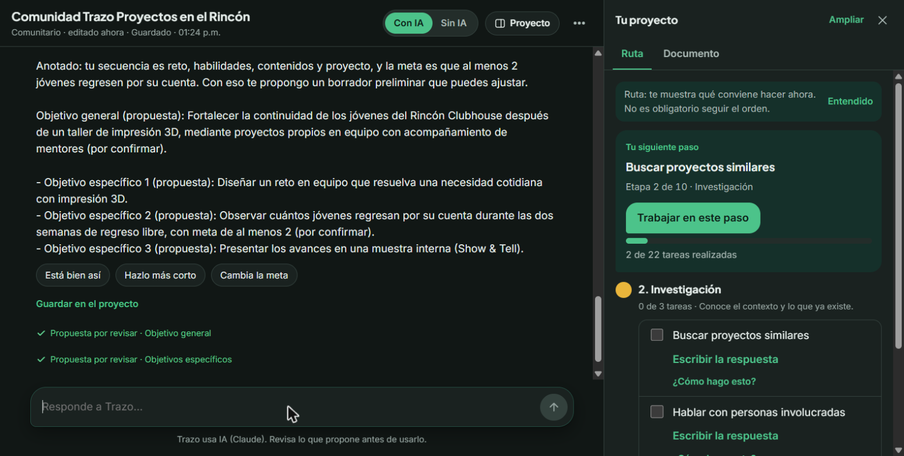
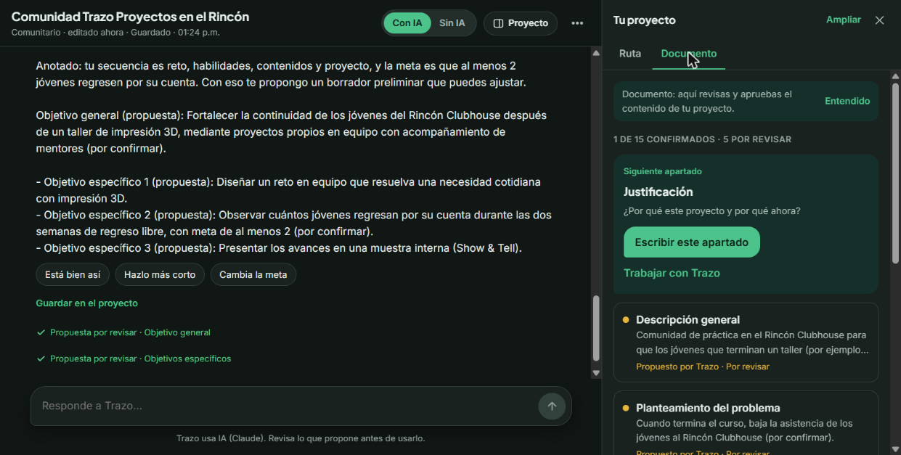

# Qué es Trazo Proyectos

**Trazo Proyectos** es una app Android y una web, gratuitas y sin publicidad, que ayudan a **convertir una idea en un proyecto paso a paso**. La persona conversa con **Trazo**, un asistente que le hace preguntas, ordena el trabajo por etapas y arma el documento del proyecto con ella.

La creó Kevin Fernández, con el nombre de desarrollador **KL Studio**, para personas que tienen una idea y no saben por dónde empezar. Es la herramienta que usa esta comunidad, pero la comunidad no depende de ella: todo se puede hacer también con la [ruta en papel](../recursos/ruta-del-proyecto-en-papel.md).

- **Web:** https://trazo-proyectos.trazo-ia-server.workers.dev (computadora o navegador del celular, sin instalar nada)
- **App Android:** en prueba cerrada en Google Play, todavía no está abierta al público.

## Cómo funciona

1. **Cuentas tu idea** con tus palabras, por ejemplo: «Quiero hacer un huerto en mi escuela».
2. **Trazo te pregunta** lo que falta, le pone nombre al proyecto y lo crea.
3. **Recibes una ruta de etapas** según el tipo de proyecto: educativo, social, comunitario, emprendimiento, tecnológico, cultural, ambiental, científico o general. Cada etapa tiene tareas, y siempre ves cuál es tu siguiente paso. Si te trabas, el botón «¿Cómo hago esto?» te explica cómo hacer la tarea.
4. **Se arma el documento** del proyecto con sus apartados: descripción, problema, objetivos, beneficiarios, metodología, actividades, cronograma, presupuesto, indicadores y conclusiones. Lo que respondes en la ruta lo va llenando.
5. **Descargas el PDF** para imprimirlo, presentarlo o compartirlo.

## Tú decides, no la IA

- Lo que propone Trazo queda como **propuesta por revisar**. Tú lo aceptas, lo editas o lo descartas.
- Cada apartado muestra si lo **escribiste tú** o lo **propuso Trazo**, y si es un **dato propio**, una **hipótesis** o algo **verificado**.
- Trazo no inventa datos: si falta información, pregunta, y marca como «por confirmar» lo que no está comprobado.

## Con IA o sin IA

- **Con IA:** Trazo responde usando inteligencia artificial (Claude, de Anthropic), con un límite diario de uso gratuito.
- **Sin IA:** te guía con respuestas preparadas. Sirve también cuando se acaba el uso del día.

## Trabajo en equipo

Para talleres y programas con mentores existe la sección **Equipos**:

- La coordinación crea un programa y sus equipos. Cada equipo recibe dos códigos: uno para integrantes (hasta 4) y otro para mentores (hasta 3).
- Los integrantes comparten la ruta, el documento y el chat con Trazo en tiempo real.
- Los mentores lo siguen y dejan comentarios.
- La coordinación ve el avance de todos los equipos en un panel.

## Quién puede usarla

- Cualquier persona con una cuenta de Google. No hay contraseñas propias.
- En esta comunidad, los jóvenes la usan en sesiones acompañadas por sus mentores, en el Rincón.
- Quien no tenga cuenta, o prefiera no usar la app, sigue los mismos pasos con la [ruta en papel](../recursos/ruta-del-proyecto-en-papel.md).

## Privacidad, en pocas palabras

- No tiene publicidad, analítica ni seguimiento.
- Los proyectos son de cada persona. Quien tiene cuenta puede borrarla, y con ella sus proyectos en la nube.
- La política de privacidad completa está enlazada dentro de la app y de la web.

## Qué no está en este repositorio

El código, el servidor y las cuentas técnicas de Trazo Proyectos son privados y no se publican aquí. Este repositorio solo contiene lo que la comunidad necesita: acuerdos, recursos y registros.
